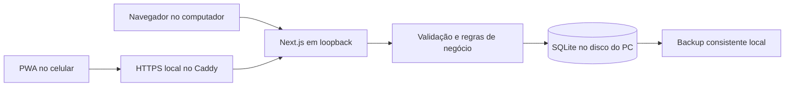

# Arquitetura

> Atualização de destino em 20/10/2026: a Central também possui entrada estática em `/crm/`, Google OAuth, domínio Apps Script e persistência privada em Sheets. Contratos e implantação em [Central na nuvem](cloud-deployment.md), verificação em [relatório](reviews/2026-10-20-publicacao.md). O restante deste documento descreve a versão local preservada. Não aplicar a ausência de autenticação local ao endpoint público.

Status: implementada em 20/10/2026. Regras de negócio: [especificação](superpowers/specs/2026-10-19-central-design.md); evidências e limites em [implementação](reviews/2026-10-20-implementacao.md). Escopo local sem autenticação preservado.

## 1. Um servidor, um banco



Escolha: Next.js App Router, TypeScript estrito, Tailwind, Drizzle com `better-sqlite3`, Zod e Pino. Um processo Node de longa duração, não funções serverless. Sem Redis, filas externas, Docker ou serviço PostgreSQL nesta fase.

SQLite substitui o PostgreSQL padrão do toolkit porque atende um usuário e poucos dispositivos, elimina serviço separado e facilita transporte/backup. O banco permanece no servidor; nunca será aberto em compartilhamento de rede. IndexedDB por aparelho foi descartado como fonte de verdade porque exigiria sincronização e resolução de conflitos entre bancos.

Node `22.22.0` e npm `10.9.4` foram reutilizados. Next `16.4.2`, React `19.3.0`, better-sqlite3 `13.0.3` e SQLite embarcado `3.53.4` foram executados no Windows. Versões fixadas no lockfile; bibliotecas restantes e versões exatas no package.json.

UI: componentes shadcn/Radix adotados seletivamente, ícones Lucide, dnd-kit para arrastar tarefas e FullCalendar **Standard** para agenda. Adaptadores isolam calendário/drag; não usar Scheduler ou recursos pagos. Resolver APIs e versões estáveis nas fontes oficiais no início da implementação; os exemplos atuais do FullCalendar já mostram v7, portanto não copiar imports de v6 automaticamente.

TanStack Query controla cache de tela, invalidação e reconsulta; não é banco offline. Zod valida entradas também no servidor. Vitest cobre domínio/integração, Testing Library os componentes relevantes e Playwright os fluxos reais. Datas usam um adaptador único de fuso; preferir Temporal com polyfill compatível já exigido pela versão estável do calendário, se houver, para evitar duas bibliotecas de datas concorrentes.

## 2. Dados e relações

IDs UUID gerados no servidor. Registros editáveis têm `version INTEGER`, `createdAt` e `updatedAt` UTC. `LocalDate` é string validada `YYYY-MM-DD`; `Instant` é ISO UTC. Valores monetários inteiros em centavos. Frentes e vínculos são validados no serviço e por constraints onde possível.

| Tabela | Campos essenciais e responsabilidade |
| --- | --- |
| `business_areas` | id, name, colorKey, commercialEnabled fixo após criação, archivedAt; quatro registros iniciais com IDs preservados pelo seed, incluindo Fórum não comercial |
| `contacts` | id, kind(pessoa/organizacao), name, email e phone normalizados, responsibleName, notes, archivedAt |
| `contact_relationships` | contactId + areaId + role únicos; relacionamento comercial por frente |
| `projects` | id, areaId, contactId?, name, objective, targetDate?, status |
| `tasks` | id, areaId? somente entrada, projectId?, title, description, status, priority, tagsJson validado, dueDate?, estimateMinutes?, waitingReason?, reviewDate?, startedAt?, completedAt?, focusDate? |
| Checklist da tarefa | JSON ordenado em tasks.checklist, com id/text/done; tags também em JSON validado |
| `opportunities` | id, contactId, areaId, offerName, estimatedCents?, source, campaign?, stage, nextAction?, nextActionDate?, lastInteractionAt?, closedAt?, lossReason?, closeVersion |
| `interactions` | id, contactId, opportunityId?, occurredAt, channel, type, summary; novos registros conservam o histórico |
| `deal_closures` | id, opportunityId, closeVersion únicos, amountCents, closedDate, projectId?, reversedAt?; preserva fechamento reaberto |
| `receivables` | id, areaId, contactId?, projectId?, opportunityId?, closureId?, description, amountCents, dueDate, cancelledAt? |
| `payments` / `payment_reversals` | pagamentos e estornos separados, amountCents e effectiveDate; estorno referencia pagamento, ambos imutáveis por triggers |
| `calendar_events` | id, areaId, title, kind, startsAt, endsAt, timeZone, location?, meetingUrl?, contactId?, projectId?, taskId?, status |
| `recurrence_series` | id, kind(task/event/receivable), areaId, payload validado por tipo, frequência fixa por kind, anchorDate original fixa, time, weekday?, dayOfMonth?, endDate?, cursor, version |
| Ocorrências | seriesId + occurrenceKey únicos nas tabelas de tarefas/eventos/previsões, isException e UUID determinístico por série/índice; não há tabela intermediária |
| `weekly_reviews` | week ISO única, checklist validado e versão |
| `settings` | chaves permitidas: locale, timeZone, availabilityWindows, forumHours, wipLimit; valores validados |
| `mutation_receipts` | operationId único, commandName, requestHash, resultJson, createdAt; replay determinístico de comandos |
| `activity_log` | entityType/id, action, version, occurredAt; alterações de estado e referências, sem cópia indiscriminada de dados pessoais |

Índices mínimos: tarefa `(areaId,status,dueDate)`, oportunidade `(areaId,stage,nextActionDate)`, previsão `(areaId,dueDate)`, evento `(startsAt,endsAt)`, pagamento `(receivableId,effectiveAt)`, contatos normalizados e chaves de recorrência. Pagamentos, estornos, fechamento e parcelas são inseridos em transações curtas.

Toda entidade vinculada a projeto, oportunidade ou tarefa deve usar a mesma frente do vínculo; evento com tarefa e projeto deve respeitar também o projeto da tarefa. Validar criação e alteração dos dois lados: mudar a frente de uma tarefa/projeto não pode invalidar vínculos existentes. Um contato pode cruzar frentes. Foreign keys usam RESTRICT para dados financeiros e relacionamentos de negócio.

Parcelas com `closureId` só são criadas na transação de fechamento. Valor e vínculos ficam imutáveis; cancelamento ocorre somente na reabertura transacional, que verifica recebido líquido zero em todas as parcelas, preenche `deal_closures.reversedAt`, cancela as previsões e atualiza etapa/encerramento da oportunidade. `getFinancialSummary` exclui fechamentos invalidados. Previsões manuais e de série não recebem `closureId`; a correção individual não pode contornar as regras de fechamento.

## 3. Contratos compartilhados

Tipos compartilhados em `src/lib/contracts.ts`:

```ts
type LocalDate = string;
type Instant = string;
type MoneyCents = number; // inteiro seguro validado
type CommandMeta = { operationId: string; expectedVersion?: number };
type Page<T> = { items: T[]; total: number; page: number; pageSize: number };
type ApiError = {
  code: 'VALIDATION' | 'CONFLICT' | 'NOT_FOUND' | 'DUPLICATE_OPERATION'
    | 'UNAVAILABLE' | 'FORBIDDEN_ORIGIN' | 'BUSINESS_RULE';
  message: string;
  fieldErrors?: Record<string, string>;
  currentVersion?: number;
};
```

Não usar as aliases como validação: schemas refinam datas, UUIDs, inteiros e limites. Comando sem `operationId` válido é rejeitado. Toda edição exige `expectedVersion`. Erros HTTP: 400 validação, 403 origem, 404 inexistente, 409 conflito/reuso de operação com outro payload, 422 regra, 503 indisponibilidade temporária. Nunca devolver stack ou caminho do banco.

Contrato central: `runCommand<T>(name, input, meta, handler): T`. Dentro da mesma transação, localizar recibo por operationId; payload idêntico retorna resultado original; diferente gera 409. Executar mudança, registrar resultado e histórico atomicamente. Chaves de pagamentos/fechamentos permanecem guardadas, sem expiração na V1.

As versões são verificadas dentro da transação SQLite `immediate`, antes de atualizar e incrementar a versão; o lock de escrita serializa os comandos. Conflito não mescla dinheiro, agenda ou status. Recibo idempotente é consultado antes da versão, permitindo recuperar resposta perdida. Schemas de PATCH não aplicam defaults a campos omitidos.

Operações de saldo verificam os registros atuais dentro da transação, não os números enviados pelo cliente. Dois pagamentos simultâneos não podem ultrapassar o saldo. Receber/estornar usa expectedVersion da previsão e incrementa sua versão, mesmo que o registro adicionado seja imutável. Confirmação de conflito de agenda envia fingerprint dos conflitos exibidos; o servidor recalcula e rejeita a confirmação se o conjunto ou versões mudarem.

## 4. API e atualização entre dispositivos

REST same-origin em `src/app/api/`. Leituras paginadas por `page/pageSize`, padrão 25 e máximo 100. Kanban e funil consultam cada coluna em lotes de 25 com total e Carregar mais. Agenda consulta até 93 dias; disponibilidade usa datas inclusivas e todos os compromissos pessoais. Busca global POST limita 20 por tipo; busca em listas tem total e paginação SQL. Texto pessoal não vai para URL.

| Recurso | Leituras | Comandos POST |
| --- | --- | --- |
| Tarefas/projetos/contatos | lista, ficha, checklist | criar, editar, mover, concluir, reabrir, arquivar |
| Comercial | oportunidades e histórico | registrar interação/próximo passo, ganhar, perder, reabrir |
| Financeiro | previsões, extrato e resumo | criar/corrigir previsão, receber, estornar, cancelar |
| Agenda | eventos e disponibilidade | criar, editar, cancelar; exportar ICS por leitura |
| Rotinas | séries e revisão semanal | criar/editar/encerrar série, salvar checklist |
| Hoje/busca | agregações filtradas e busca | escolher/remover foco do dia |
| Configurações | frentes e preferências | editar preferências, criar/arquivar frente |
| Portabilidade | CSV filtrado e estado do backup | solicitar backup consistente; nenhuma rota de restauração |

Cada rota é um adaptador fino: valida, chama serviço e transforma erro. Mesmo serviço alimenta UI e testes. `GET` não grava nem gera ocorrências.

Escritas passam por POST `/api/commands` com `{command,input,meta}`. Backup manual é POST `/api/backup`; restore existe somente na CLI. Consultas revalidam a cada 30 segundos em primeiro plano e ao focar. Formulários mantêm registro e versão originais enquanto abertos; reconsulta não reescreve rascunhos.

Queries com `Cache-Control: no-store`; sem cache estático de dados pessoais no Next. Reconsulta ao focar a janela, após mutação e a cada 30 segundos apenas com tela visível. Rascunhos em edição não são substituídos pela reconsulta. Sem WebSocket na V1.

Timeout de 15 segundos; leitura pode tentar novamente uma vez. Escrita com resposta incerta mantém operationId e mostra **Confirmar resultado / Tentar novamente**; reenvio usa a mesma chave e payload. Mudança de payload só recebe chave nova após resolver o resultado anterior. Valores digitados permanecem em memória enquanto a página existir; não prometer recuperação após fechar o navegador.

## 5. Persistência, recorrência e backup

Banco padrão em `%LOCALAPPDATA%\Central\data\central.sqlite`, com override absoluto via `CENTRAL_DATA_DIR`. Não persistir em `.next`, temp, pasta do OneDrive ou no checkout. Um servidor por diretório de dados, com lock de processo e diagnóstico de porta/lock ocupado.

`foreign_keys=ON`, `busy_timeout=5000`, WAL e `synchronous=FULL`, com confirmação dos PRAGMAs. Antes de ativar WAL, verificar `sqlite_version()`: mínimo 3.51.3, ou backport oficial corrigido 3.44.6/3.50.7. Versão antiga bloqueia esse modo; selecionar driver estável com correção, sem suprimir o aviso. Ver [fonte SQLite](https://www.sqlite.org/wal.html).

Migrations versionadas em `drizzle/`, aplicadas explicitamente pelo comando de inicialização após backup; não executar durante build, import de módulo ou request. Erro conserva banco anterior. A base real nasce com frentes/configurações; demonstrações usam arquivo separado escolhido por comando explícito.

Rotina de recorrência: `materializeOccurrences(now, horizonDays=60)` no startup e timer de uma hora, apenas no processo servidor. `src/instrumentation.ts` inicia `src/server/jobs.ts` somente no runtime Node com `CENTRAL_RUN_JOBS=1`, variável fornecida pelo launcher local e ausente em build/testes. Guard por processo impede duplicação no hot reload. Cada lote de até 100 ocorrências grava entidade e chave única na mesma transação. `generatedThroughIndex` avança só após sucesso, sem mudar a identidade quando uma data é editada. Edição de série reconcilia futuros elegíveis pelo índice, preserva IDs/exceções e revalida a prévia contra versões atuais. Limites, vigência e recuperação seguem a especificação §7. Nenhum job depende de o telefone estar aberto.

Backup online via API do driver. Criar `.partial`, concluir, abrir cópia, executar `integrity_check` e `foreign_key_check`, registrar versão do schema, hash e data; somente então renomear. Um backup diário no primeiro uso/startup do dia, checado novamente a cada hora com servidor ativo; conservar 14 diários e 8 semanais. Backups feitos manualmente não são apagados pela retenção automática.

Pasta padrão `%LOCALAPPDATA%\Central\data-backups`, ou `demo-data-backups`; diretório irmão da base. Cópia no mesmo disco não cobre perda do disco; Configurações permite baixar cópia externa. Não há envio automático à nuvem. Falha da recorrência não impede tentativa de backup diário.

Restaurar somente pela CLI local com app parado: validar arquivo em diretório temporário, schema compatível, integridade e FKs; preservar backup do atual; fechar conexões; substituir atomicamente o arquivo; remover apenas sidecars WAL/SHM do banco substituído após fechar tudo. Nunca aplicar WAL antigo à cópia restaurada. Em falha, conservar original. Testes usam diretórios descartáveis.

## 6. Execução local e PWA

Scripts `dev` e `start` vinculam Next explicitamente a `127.0.0.1` e verificam schema/lock antes de iniciar. Modo LAN separado mantém Node em loopback e Caddy no IPv4 privado explícito, com TLS interno e allowlist de Host/Origin. Instalação de confiança e firewall permanecem manuais, restritos à rede privada/dispositivos definidos; não há roteador, túnel ou publicação automática.

Origem LAN estável, por exemplo `https://<ip-reservado>:3443`. O computador precisa permanecer ligado e sem suspensão durante o uso móvel. `localhost` no telefone não aponta para o computador.

Manifesto com nome Central, short_name Central, `display: standalone`, scope/start_url `/`, ícones 192/512 e maskable, ícone Apple. Service worker próprio e pequeno limita-se a manifesto, ícones e `offline.html` estático; nunca cacheia API, páginas com registros, backups ou respostas de mutação. `offline.html` não contém dados pessoais.

Atualização disponível é anunciada; ativação/reload só ocorre após salvar ou descartar rascunhos. Não atualizar à força durante pagamento ou formulário. Não instalar dependência de sincronização offline.

Caddy emite certificado pela CA local. O aparelho precisa confiar no certificado raiz público; nunca copiar a chave privada. iOS exige confiança SSL habilitada e instalação pelo menu de compartilhar. Android varia por navegador: validar se o resultado é PWA standalone ou atalho e registrar o observado. Não prometer WebAPK local universal.

## 7. Limites de segurança proporcionais

- Sem login por requisito. Quem acessar a porta autorizada da LAN poderá operar todos os dados.
- Validar Host em todas as requisições; mutações requerem Origin exata permitida e Content-Type JSON, sem CORS permissivo. Rejeitar Origin ausente nas rotas de negócio; ferramentas locais usam serviços diretamente ou enviam origem válida.
- Headers encaminhados só são confiados quando vêm do proxy local. Sem mutações por GET.
- Schemas de entrada, tamanho de corpo limitado a 256 KB, queries parametrizadas, texto escapado na renderização e URLs de reunião `https:`.
- Logs estruturados contêm id da operação, duração, entidade e código; não corpo, nome, telefone, e-mail, descrição, query de busca ou valores bancários.
- Sem telemetria, analytics, imagens, fontes CDN ou integrações externas em runtime. Fonts serão hospedadas localmente.
- Backup e exportação contêm dados pessoais; não versionar nem anexar aos relatórios de teste.

## 8. Estrutura

```text
src/app/                         rotas, páginas e adaptadores HTTP
src/components/ui/               primitives acessíveis compartilhados
src/components/layout/           navegação, frente selecionada, criar
src/components/data/             lista/tabela, filtros e estados
src/features/work/               tarefas, projetos e templates
src/features/crm/                contatos, oportunidades e histórico
src/features/calendar/           agenda e capacidade
src/features/finance/            previsões, pagamentos e indicadores
src/features/routines/           séries e revisão semanal
src/features/overview/           Hoje e busca
src/features/settings/           frentes e preferências locais
src/db/schema/                   schema por domínio
src/db/index.ts                  conexão exclusiva e PRAGMAs
src/lib/                        contratos, dinheiro, tempo, comandos, segurança
src/styles/tokens.css            saída dos tokens de DESIGN.md
public/                         manifesto, ícones, service worker e offline.html
scripts/                        iniciar, backup, restaurar e verificar ambiente
tests/                          integração, E2E e fixtures isoladas
drizzle/                        migrations SQL revisadas
```

Criar arquivos somente quando a tarefa que os usa começar. Sem classes de repositório genéricas, barramento de eventos ou estrutura vazia por antecipação. Serviços de cada domínio mantêm fronteiras e transações explícitas.
